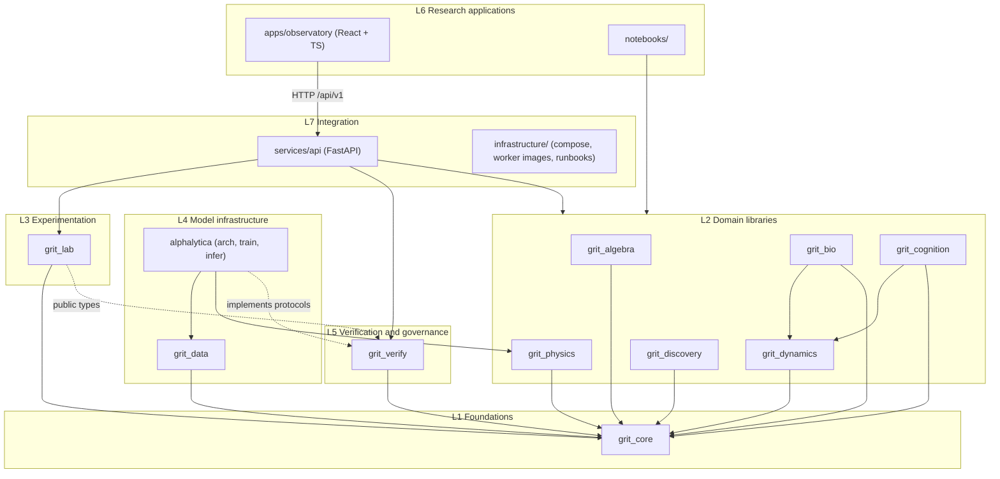
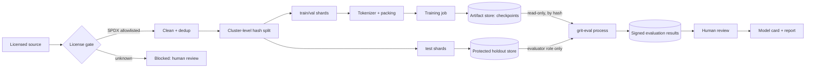
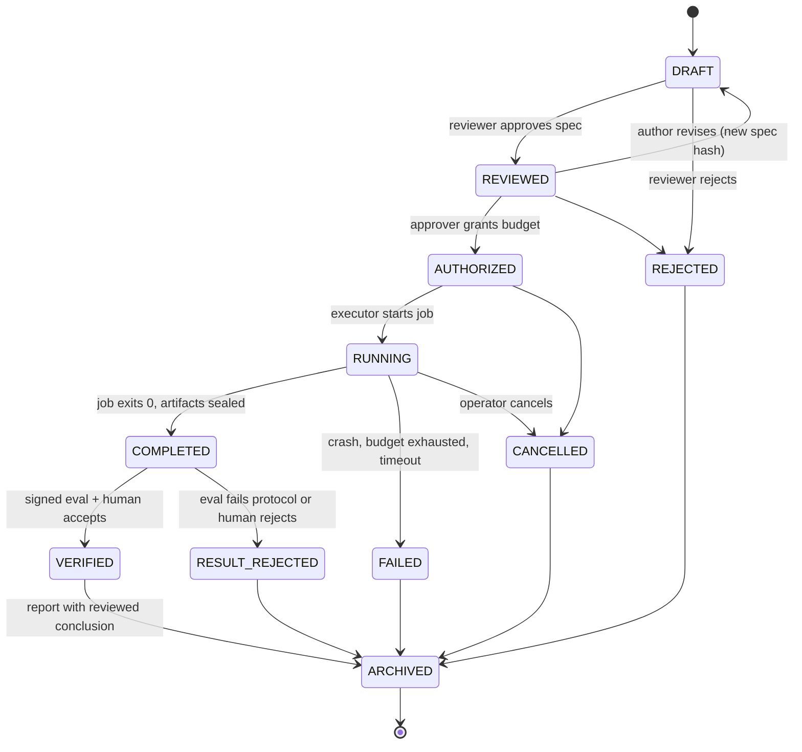
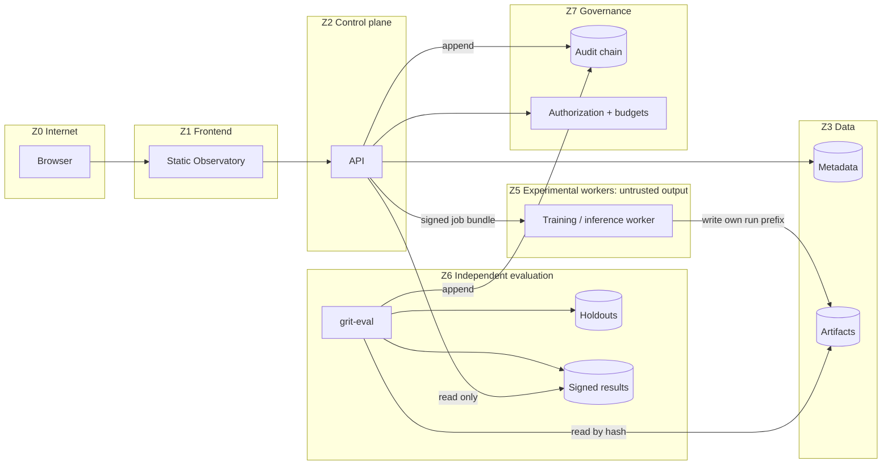
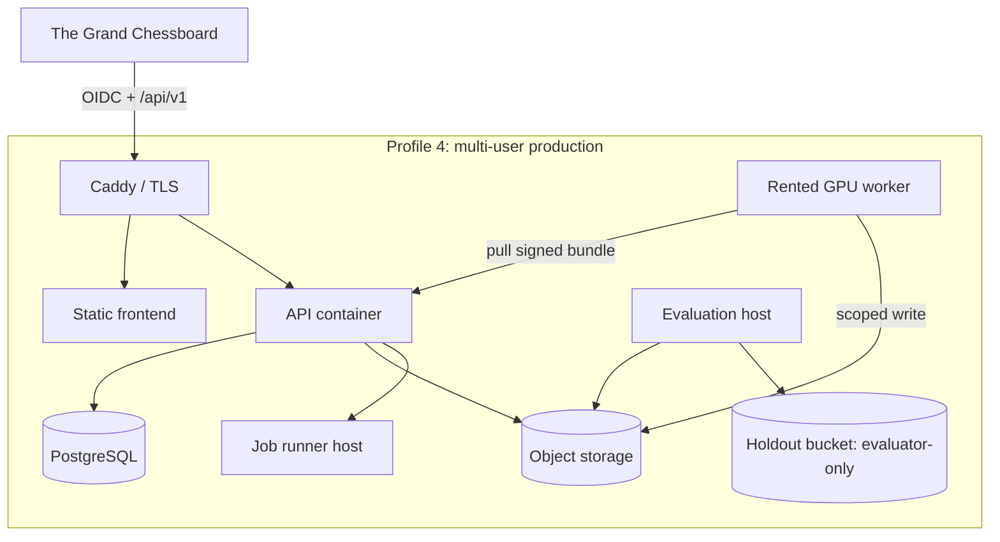

# GRIT Computational Science Platform: Master Architecture

Version 0.1, 2026-11-25. Status: proposed, pending owner review.

GRIT (General Recursive Intelligence Theory) needs a computational counterpart: software that turns the treatise's definitions into code, runs controlled experiments against them, and keeps an honest record of what the evidence shows. This document is the architecture for that software. The build sequence lives in [MASTER_BUILD_PLAN.md](MASTER_BUILD_PLAN.md). The prompts that implement it live in [prompts/](prompts/), indexed in [manifests/prompts.json](manifests/prompts.json).

## 1. Executive technical overview

GRIT is a **modular monolith**: one Python monorepo of small packages with enforced one-way dependencies, one FastAPI process, one React app, one SQLite file and one content-addressed artifact directory. That's the whole system on day one. It runs on a 16 GB MacBook Air.

Three things make it more than a pile of scientific scripts:

1. **A functional core.** Every scientific function is pure: arrays and frozen dataclasses in, arrays and frozen dataclasses out, randomness only through an explicit `numpy.random.Generator`. No I/O, no globals, no hidden state. Infrastructure (storage, HTTP, process control) wraps the core and never leaks into it.
2. **A governed lab.** Experiments move through an explicit state machine (`DRAFT → REVIEWED → AUTHORIZED → RUNNING → COMPLETED → VERIFIED → ARCHIVED`). Nothing runs without a hypothesis, a baseline, a fixed budget and a pre-registered evaluation protocol. Every transition lands in a hash-chained audit log.
3. **An independent evaluator.** `grit_verify` depends on `grit_core` and nothing else. It never imports training code. It runs in its own process, owns the protected holdout data, and signs its results. An experimental model can't touch it, and neither can the code that trains one.

The Alphalytica model program sits on top of this. It starts with a ~4M parameter decoder-only Transformer trained on a laptop and climbs to a ~500M parameter research model only if each rung of the ladder earns the next one with documented evidence. A 500M model is a research instrument. Nobody should expect frontier reasoning from it, and this architecture doesn't assume any.

Scale is deferred until measured. PostgreSQL, object storage, GPU workers, queues and multiple API processes each have a written trigger condition ([ADR-0011](decisions/ADR-0011-deferred-infrastructure-triggers.md)). Until the trigger fires, the simple thing stays.

## 2. Layered system architecture

| Layer | Name | Packages / components | May depend on |
|---|---|---|---|
| L1 | Scientific foundations | `grit_core` | numpy, scipy, sympy, networkx, pint (stdlib otherwise) |
| L2 | Domain libraries | `grit_algebra`, `grit_dynamics`, `grit_bio`, `grit_cognition`, `grit_physics`, `grit_discovery` | L1, plus the explicit intra-L2 edges below |
| L3 | Experimentation | `grit_lab` | L1, L5 public types |
| L4 | Model infrastructure | `grit_data`, `alphalytica` | L1, `grit_physics`, `grit_verify.protocols` |
| L5 | Verification and governance | `grit_verify` | L1 only |
| L6 | Research applications | `apps/observatory`, `notebooks/` | L7 API over HTTP (app); any package (notebooks, read-only use) |
| L7 | Integration and deployment | `services/api`, `infrastructure/` | L1 to L5 |

Layer numbers describe purpose, not import order. The import rules are the thing that matters, and they're enforced by `scripts/check_layers.py` against [architecture/layers.toml](architecture/layers.toml) on every CI run.

Allowed intra-L2 edges (everything else is forbidden):

- `grit_bio → grit_dynamics` (biology simulations are dynamical systems)
- `grit_cognition → grit_dynamics` (learning curves and memory decay are fitted dynamical models)
- `grit_discovery → grit_core` only

Hard prohibitions:

- `grit_verify` imports nothing from `grit_lab`, `alphalytica`, `grit_data` or any L2 package. Evaluation logic must not be reachable from the code it evaluates.
- `grit_core` imports no torch, no web framework, no database driver.
- `alphalytica` imports nothing from `grit_verify` except `grit_verify.protocols` (the interface the evaluator needs models to satisfy). Dependency inversion: the evaluator owns the contract.
- `apps/observatory` reaches Python only through the versioned HTTP API.



More diagrams: [diagrams/](diagrams/) holds the data flow, execution flow, trust boundary and deployment topology diagrams as Mermaid sources. They render on GitHub.

## 3. Functional core, imperative shell

The rule is mechanical, so agents can follow it without judgment calls:

| Lives in the core (L1, L2, `grit_verify` math, `alphalytica.arch`) | Lives in the shell (`grit_lab` stores, `services/api`, `alphalytica.train` loop driver, CLIs) |
|---|---|
| Pure functions over arrays and frozen dataclasses | File, database, network and process I/O |
| `Generator` passed in explicitly | Seed creation and `SeedSequence` spawning |
| Raises typed `GritError` subclasses | Catches them, logs, maps to HTTP or exit codes |
| No logging (returns diagnostics in result objects) | Structured JSON logging |
| No config files (takes config objects) | Loads and hashes TOML config |

Result objects carry their own diagnostics. An ODE solve returns `OdeResult(t, y, n_steps, converged, message)`, not a bare array plus a log line. This keeps the core testable and makes provenance automatic: the shell serializes the whole result.

## 4. Data flows

Three flows cover nearly everything the platform does.

**Scientific computation (interactive).** Observatory instrument → `POST /api/v1/compute/{instrument_id}` with validated parameters → API looks up the registered pure function → runs it under a CPU time limit → result plus provenance (`code_version`, `input_hash`, `units`, `assumptions`, `synthetic: true|false`) → cached by input hash → rendered.

**Experiment (governed).** Researcher writes `ExperimentSpec` (TOML) → `grit lab submit` → reviewer approves (`REVIEWED`) → approver authorizes against a budget (`AUTHORIZED`) → executor launches an isolated job (`RUNNING`) → artifacts written to content-addressed store, run record to SQLite (`COMPLETED`) → `grit-eval` evaluates against the pre-registered protocol and signs the result (`VERIFIED` only if a human accepts the signed result) → report and archive (`ARCHIVED`).

**Model training (governed, compute heavy).** Dataset manifest → license gate → clean, dedup, split → tokenizer → packed token shards (all hashed and versioned) → training job under an `AUTHORIZED` experiment → checkpoints (safetensors + sha256 manifest) → evaluator reads checkpoint by hash, read-only → signed evaluation → model card.



## 5. Execution flow and the experiment state machine



Guards (enforced in the pure transition function, tested exhaustively):

- `DRAFT → REVIEWED` needs every required spec field and a reviewer who isn't the author.
- `REVIEWED → AUTHORIZED` needs an approver role, a budget within the approver's limit, and a frozen evaluation protocol hash.
- `RUNNING` can only be entered by the executor service identity.
- `COMPLETED → VERIFIED` needs a signed evaluation whose protocol hash matches the one frozen at authorization. A mismatch is an automatic `RESULT_REJECTED`.
- Any spec edit after `REVIEWED` creates a new spec hash and returns the experiment to `DRAFT`. There's no way to change the hypothesis after seeing the data.
- `FAILED` keeps partial artifacts. Failure is data.

## 6. Trust boundaries

Eight zones. Arrows that cross a zone boundary are authenticated, authorized and audited.

| Zone | Contents | Trust | Can reach |
|---|---|---|---|
| Z0 | Public internet, browsers | Untrusted | Z1 only |
| Z1 | Observatory static frontend | Untrusted code running on user devices | Z2 over HTTPS |
| Z2 | API / control plane | Trusted, authenticates every request | Z3, Z4 job queue, Z7 append |
| Z3 | Metadata DB, artifact store | Trusted data | (passive) |
| Z4 | Background scientific jobs | Semi-trusted, user parameters | Z3 scoped write |
| Z5 | Experimental training and inference workers | **Untrusted outputs.** Model weights and generated text are data, never code. | Z3: write to own run prefix, read own inputs. Nothing else. |
| Z6 | Independent evaluation | Trusted, isolated | Z3 read checkpoints by hash; holdout store (exclusive); own results store |
| Z7 | Governance: audit log, authorization, budgets | Most trusted | Append-only from Z2 and Z6 |



What a Z5 worker never gets: persistent credentials, holdout access, write access to any other run, the ability to change its own budget, the audit log, the authorization tables, or anything about deployment. Its token is scoped to one job, expires at the job's budget deadline, and is revoked on exit. Full detail in [specifications/security.md](specifications/security.md).

## 7. Deployment topology

Five profiles, each a strict superset of the previous only where a measured need says so.

| # | Profile | What runs where | When |
|---|---|---|---|
| 1 | Local development | Everything on the MacBook Air: `uv run`, Vite dev server, SQLite file, `./artifacts/` | Day one |
| 2 | Single server | One VM: Caddy (TLS) → API container; static frontend; SQLite on a persistent volume; nightly backup to object storage | First external user |
| 3 | + GPU research workers | Profile 2 plus rented GPU instances that pull a signed job bundle, push artifacts to object storage, and self-terminate | First workload that exceeds ~6 h on MPS or needs >10 GB training memory |
| 4 | Multi-user production | PostgreSQL, object storage, separate API / job / eval hosts on a private network, OIDC SSO shared with The Grand Chessboard | More than ~5 concurrent writers, or a second institution |
| 5 | Horizontal scaling | Multiple API replicas behind a load balancer, a real queue, autoscaled workers | Sustained API p95 > 300 ms at measured load, or job queue wait > 1 h |



Details, configs and runbooks: [specifications/deployment.md](specifications/deployment.md).

## 8. Repository architecture (refined)

The directive's proposed tree is a good starting sketch. Measured against actual requirements, it changes in five places:

1. `datasets/processing/` code moves into the `grit_data` package. Code belongs in packages; `datasets/` holds only manifests and schemas (data, not code).
2. `models/alphalytica/evaluation/` disappears. Model evaluation lives in `grit_verify.model_eval` so the evaluator stays independent of the thing it evaluates.
3. `models/alphalytica/{architecture,tokenization,training,inference}` become subpackages `alphalytica.arch`, `alphalytica.train`, `alphalytica.infer`. Tokenization moves to `grit_data.tokenizers` because evaluation (bits per byte) and data preparation both need it without importing training code.
4. `services/inference/` is not created until a deployed inference service exists (Profile 3). Local inference is a library call.
5. `infrastructure/cloud/`, `infrastructure/monitoring/`, `infrastructure/registries/` aren't created until their prompts run. No empty directories.

```
grit/
  README.md  AGENTS.md  pyproject.toml  uv.lock  Makefile
  docs/
    architecture/   decisions/   specifications/   security/   research/   registry/
  packages/
    grit_core/  grit_algebra/  grit_dynamics/  grit_bio/  grit_cognition/
    grit_physics/  grit_discovery/  grit_verify/  grit_lab/  grit_data/
  models/
    alphalytica/          # src/alphalytica/{arch,train,infer}/
  datasets/
    manifests/  schemas/
  experiments/            # ExperimentSpec TOML files, by domain
  configs/                # immutable model / training / eval configs (TOML)
  notebooks/
  benchmarks/
  apps/observatory/
  services/api/
  infrastructure/         # local/ docker/ then gpu/ prod/ as prompts create them
  scripts/
  prompts/                # copied from grit-engineering/, with status + reports
  tests/                  # cross-package integration and e2e only
```

`artifacts/` and the SQLite file are runtime state, gitignored, and located by `GRIT_DATA_DIR` (default `./.grit/`).

The file-by-file manifest is [manifests/files.json](manifests/files.json) (generated from the prompt catalog: every file, the prompt that creates it, the prompts that modify it, and its tests). The human-readable version with ownership is [architecture/repository-manifest.md](architecture/repository-manifest.md).

Where this repository lives is [ADR-0001](decisions/ADR-0001-dedicated-grit-repository.md): a dedicated `grit` repository, with this `grit-engineering/` folder as its seed.

## 9. Scientific module architecture (summary)

Ten families, 112 submodules. Full contracts per module (purpose, scope, interfaces, schemas, foundations, reference algorithms, outputs, errors, tests, benchmarks, security, acceptance): [specifications/scientific-modules.md](specifications/scientific-modules.md).

| Family | Role | Key dependencies | Prompts |
|---|---|---|---|
| `grit_core` | Types, units, numerics, probability, statistics, information, graphs, optimization, validation | numpy, scipy, networkx, pint | P007 to P018 |
| `grit_algebra` | State spaces, typed operators, composition, relations, invariants, fixed points, symbolic math | core, sympy; z3 optional | P019 to P023 |
| `grit_dynamics` | Discrete, continuous and stochastic systems, stability, bifurcations, control, scenarios | core | P024 to P028 |
| `grit_bio` | Kinetics, regulatory networks, population genetics, landscapes, neuron and synapse models | core, dynamics | P029 to P035 |
| `grit_cognition` | Capability profiles, learning curves, retention, calibration, transfer, task generators | core, dynamics | P036 to P039 |
| `grit_physics` | FLOPs, memory, latency, energy, scaling laws, Pareto analysis, cost estimation | core | P040 to P042 |
| `grit_discovery` | Literature, claims, hypotheses, concept graphs, lineage, meta-analysis | core | P043 to P045 |
| `grit_lab` | Experiment specs, state machine, stores, audit, authorization, budgets, execution, reports | core, verify types | P047 to P053 |
| `grit_verify` | Contracts, regression, statistical validation, benchmarks, holdouts, signed evaluation | core only | P046, P054 to P058, P077 to P080 |
| Observatory | API, frontend, visualization, ~50 instruments, workspaces, notebooks | API over HTTP | P082 to P095 |

## 10. Technology decision matrix

Every row answers the directive's seven questions. "Exit" means how we'd leave if it goes wrong.

| Technology | Why needed | Why not simpler | Integration cost | Ops complexity | Hardware | Security | Exit |
|---|---|---|---|---|---|---|---|
| Python 3.12 | Scientific ecosystem | n/a, it is the simple option | None | Low | Any | Supply chain via PyPI, mitigated by lockfile hashes | n/a |
| uv (workspace) | Fast, locked, multi-package installs | pip + venv has no workspaces or universal lock | Low | Low | Any | Hash-pinned lock | Lockfile exports to `requirements.txt` |
| NumPy | Arrays | Lists are 100x slower and untyped | None | None | Any | Low | n/a |
| SciPy | ODEs, optimization, stats, special functions | Reimplementing solve_ivp or BCa bootstrap is a bug farm | Low | None | Any | Low | n/a |
| SymPy | Symbolic algebra, Jacobians | Hand-derived Jacobians are wrong eventually | Low | None | Any | **`parse_expr`/`sympify` call `eval`.** We never pass user strings to them; see P022 safe parser | Restrict to internal use |
| NetworkX | Graph algorithms incl. d-separation | Writing graph algorithms is wasted effort at our scale | Low | None | Any | Low | rustworkx if profiling demands |
| pint | Units at API and config boundaries | Hand-rolled units miss conversions | Low, boundary only | None | Any | Low | Units are only at boundaries, so removal touches few files |
| PyArrow + Parquet | Columnar results, token shards metadata | CSV loses types; pickle is unsafe | Low | None | Any | Parquet is data-only | n/a |
| DuckDB | Analytical queries over Parquet | SQLite is row-oriented and slow on scans | Low (embedded) | None | Any | Read-only usage | Plain pyarrow compute |
| SQLite | Local metadata, experiment registry | JSON files lack transactions | Very low (stdlib) | None | Any | File permissions | SQL is portable to PostgreSQL; migrations are plain SQL |
| PostgreSQL | Multi-user concurrent writes | SQLite serializes writers | Medium | Medium | Small VM | Network auth, TLS | Deferred until ADR-0011 trigger |
| Object storage (S3-compatible) | Checkpoints and datasets beyond one disk | Local disk doesn't survive instance loss | Medium | Low (managed) | n/a | Bucket policies, scoped keys | Store interface has a local FS implementation |
| PyTorch | Model definition and training | numpy has no autograd or GPU kernels | Medium | Medium | CPU, MPS, CUDA | `torch.load` pickle risk: weights in safetensors, `weights_only=True` everywhere | Arch is plain modules; ports to MLX/JAX |
| HF `tokenizers` | Fast byte-level BPE training | Pure-Python BPE is fine at 4M params and too slow at 10B tokens | Low | None | Any | Low | Byte-level reference tokenizer always exists |
| safetensors | Weight serialization | Pickle executes code on load | Low | None | Any | Removes arbitrary code execution on load | n/a |
| pytest + Hypothesis | Tests and property tests | unittest lacks fixtures and property testing | Low | None | Any | None | n/a |
| Ruff | Lint and format | flake8+black+isort is three tools | Low | None | Any | None | n/a |
| mypy (strict) | Static types | Pyright is also fine; mypy has the numpy plugin history | Low | None | Any | None | Pyright drop-in |
| FastAPI + pydantic | API with schema validation and OpenAPI | Flask lacks typed validation and schema generation | Low | Low | Any | Validation at the boundary | Starlette underneath |
| React + TypeScript + Vite | Observatory UI | Server-rendered templates can't do interactive instruments | Medium | Low (static build) | Any browser | CSP, no `dangerouslySetInnerHTML` | Standard stack |
| D3 | Scientific charts with exact control of axes and units | Chart libraries hide scales and units we must expose | Medium | None | Browser | Low | Plot primitives are isolated in `src/viz` |
| TanStack Query + Zustand | Server cache and small UI state | Redux is ceremony for this size | Low | None | Browser | None | Plain React context |
| Docker | Reproducible server and GPU images | Bare-metal setup drifts | Medium | Medium | Any | Non-root images, pinned digests | Images are just Dockerfiles |
| Caddy | TLS and reverse proxy | nginx needs manual cert config | Low | Low | Any | Auto TLS | nginx |
| OpenTelemetry | Traces when there are multiple services | Structured logs suffice for one process | Medium | Medium | n/a | Telemetry may leak data: allowlist attributes | Deferred to Profile 4 |
| MLX | Faster Apple Silicon training | MPS may be enough | Medium | Low | Apple Silicon only | Low | Conditional prompt P117, only if profiling shows MPS < 50% of MLX throughput |
| Z3 / Lean | Formal checks of finite invariants and proofs | Property tests can't prove universals | High | Medium | Any | Run in sandbox, untrusted input | Optional extras, never required by core |
| JAX, Julia, C++, Rust, CUDA, Triton | Performance | Not needed until a profile says so | High | High | Varies | Varies | Not adopted. ADR-0012 states the profiling bar that admits one |

## 11. Cross-cutting rules every prompt inherits

These are restated in [AGENTS.md](AGENTS.md) so a coding agent sees them without reading this file.

- Randomness: every stochastic function takes `rng: numpy.random.Generator` (or a `torch.Generator`). No module calls `np.random.seed`, `random.seed` or `torch.manual_seed` except the seeding utility in the shell.
- Units: SI internally, always. Units appear at boundaries (config, API, display) as pint quantities and are converted once.
- Floats: `float64` in the scientific core unless a function documents otherwise. Models choose their own precision.
- Errors: subclasses of `grit_core.errors.GritError`. Never return `NaN` silently; raise `NumericalError` or return a result object with `converged=False`.
- Provenance: anything persisted carries `code_version` (git commit), `config_hash`, `input_hashes`, `created_at` (UTC ISO 8601) and `synthetic: bool`.
- Traceability: every public scientific function has a registry concept ID (`GRIT-C-####`) in its docstring and at least one test marked `@pytest.mark.traces("GRIT-C-####")`.
- Security: no `eval`, `exec`, `pickle.load`, `torch.load` without `weights_only=True`, `yaml.load` without `SafeLoader`, `subprocess` with `shell=True`, or user input in file paths without normalization against an allowed root.

## 12. Specification index

| # | Deliverable | Location |
|---|---|---|
| 1 | Executive technical overview | §1 above |
| 2 | Complete system architecture | §2 to §8 above, [diagrams/](diagrams/) |
| 3 | Scientific module architecture | [specifications/scientific-modules.md](specifications/scientific-modules.md) |
| 4 | Model architecture research plan | [specifications/model-research-plan.md](specifications/model-research-plan.md) |
| 5 | Training infrastructure | [specifications/training.md](specifications/training.md) |
| 6 | Inference infrastructure | [specifications/inference.md](specifications/inference.md) |
| 7 | Evaluation and verification | [specifications/evaluation.md](specifications/evaluation.md) |
| 8 | Data architecture | [specifications/data.md](specifications/data.md) |
| 9 | Security architecture | [specifications/security.md](specifications/security.md) |
| 10 | Deployment architecture | [specifications/deployment.md](specifications/deployment.md) |
| 11 | Repository and file manifest | §8 above, [architecture/repository-manifest.md](architecture/repository-manifest.md), [manifests/files.json](manifests/files.json) |
| 12 | Technology decision matrix | §10 above |
| 13 | Architecture decision records | [decisions/](decisions/) |
| 14 | Prompt dependency graph | [manifests/dependencies.json](manifests/dependencies.json), [diagrams/prompt-dag.mmd](diagrams/prompt-dag.mmd) |
| 15 | Implementation prompt index | [manifests/PROMPT_INDEX.md](manifests/PROMPT_INDEX.md), [manifests/prompts.json](manifests/prompts.json) |
| 16 | Individual prompt files | [prompts/](prompts/) |
| 17 | Testing and acceptance matrix | [specifications/testing.md](specifications/testing.md), [manifests/acceptance.json](manifests/acceptance.json) |
| 18 | Compute and cost estimation | [specifications/compute-cost.md](specifications/compute-cost.md) |
| 19 | Phased roadmap | [MASTER_BUILD_PLAN.md](MASTER_BUILD_PLAN.md) |
| 20 | Documentation standards | [specifications/documentation-standards.md](specifications/documentation-standards.md) |
| + | Observatory and UI architecture | [specifications/observatory.md](specifications/observatory.md) |

## 13. What I don't know yet

- The treatise's own definitions. I haven't seen it. Wherever a module encodes a GRIT-specific concept (capability metrics, recursive improvement operators), the spec marks it `provisional` in the registry, implements a documented standard stand-in, and requires a human to replace or confirm it against the relevant chapter. Nothing GRIT-specific ships as `definition` status without that review.
- Dataset licenses. Candidate corpora are named in [specifications/data.md](specifications/data.md), but each license must be verified at ingestion time by a human. The license gate blocks anything unverified.
- GPU prices and availability. All cost figures are formulas with prices as inputs. The example numbers are illustrations, not quotes.
- Whether MPS is fast enough for Generation 1. The plan measures it in P081 and only then decides on MLX or rented GPUs.
