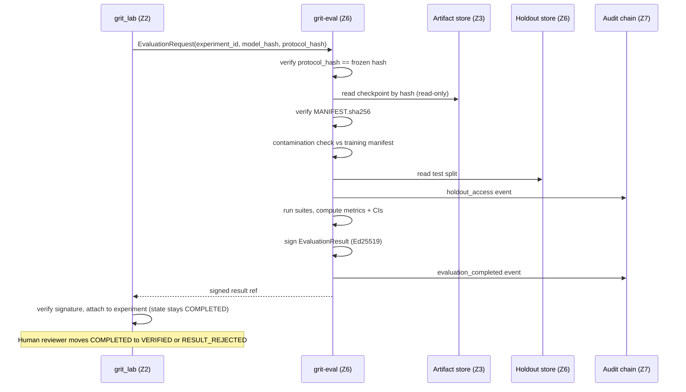

# Evaluation and Verification Specification

The evaluator is independent in code (imports `grit_core` only), in process (its own entrypoint, `grit-eval`), in data (it alone holds holdouts) and in authority (it signs results with a key nothing else holds). Prompts P054 to P058 and P077 to P080.

## Independence, concretely

| Property | Mechanism | Test that proves it |
|---|---|---|
| Training code can't reach evaluation logic | Layer rules: `alphalytica`, `grit_data`, `grit_lab` may import only `grit_verify.protocols` and public result types | `check_layers.py` in CI; P115 bypass test |
| Evaluation can't be steered by the model's code | Evaluator loads weights through its own pinned loader path: `grit_verify` calls a provider factory registered by entry point, which receives only an artifact hash | P058 test: provider gets hash, not a path or object |
| Protocols can't change after authorization | `EvaluationProtocol.content_hash` frozen into the experiment at `AUTHORIZED`; evaluator refuses a request whose protocol hash differs | P058 test |
| Holdouts aren't visible to training | Holdout store is a separate directory (Profile 1) or bucket (Profile 3+) readable only by the evaluator identity; never mounted into Z5 workers | P115: worker attempts read, gets denied, audit records it |
| Results can't be forged | Ed25519 signature over canonical JSON of the result; public key published in the repo; lab verifies before accepting | Tampered result rejected |
| Every holdout access is recorded | Evaluator appends `holdout_access` audit events (benchmark id, request id, item count) | Audit chain verification |

On a single laptop (Profile 1) the independence is procedural plus filesystem permissions: the evaluator runs as a separate process, holdouts live under `GRIT_EVAL_DIR` with mode 0700, and the signing key is stored in the OS keychain or a 0600 file outside the repo. That's weaker than separate hosts, and the spec says so. Profile 3+ moves the evaluator to its own host.

## Benchmarks and holdouts

1. **Construction.** Procedural benchmarks come from `grit_cognition.reasoning` generators with fixed seeds, or from licensed external benchmarks ingested through `grit_data`.
2. **Commitment.** `commit_benchmark(items)` computes sha256 of each canonical item and a Merkle root. The commitment (id, version, n_items, root, timestamp) goes into the audit log and `docs/registry/benchmarks.toml` before any experiment references it.
3. **Split.** Each benchmark has a public dev split (for debugging) and a protected test split (holdout). Only the test split counts as evidence.
4. **Contamination check.** Before evaluating a model, the evaluator checks the model's training dataset manifest: exact sha256 matches of items, and 13-gram overlap between each item and the training corpus (via a hashed n-gram set built once per dataset version). Overlap above threshold (default: any exact match, or > 0.1% of items with 13-gram hits) fails the protocol.
5. **Rotation.** A benchmark whose test split was ever exposed (accidentally logged, shown in a UI) is retired and a new version generated. Exposure is itself an audit event.

## Capability taxonomy (initial, provisional)

Multiple dimensions, never a single aggregate score in reports. The taxonomy is a TOML file in `docs/registry/capability-taxonomy.toml`, reviewed by the owner against the treatise.

| Dimension | Suites | Example metric |
|---|---|---|
| Language modeling | held-out loss by domain | val bits per byte |
| Memorization vs generalization | train-vs-heldout gap; canary strings | gap in bpb; canary exposure |
| Algorithmic: copying and recall | copy, reverse, associative recall | exact match by length |
| Algorithmic: arithmetic | modular addition, multi-digit addition | exact match by digit count |
| Structural | bracket matching, sorting | exact match |
| Compositional / multi-hop | multi-hop lookup | accuracy by hop count |
| Length generalization | all algorithmic tasks at 2x and 4x training length | accuracy ratio vs in-length |
| Calibration | multiple-choice tasks scored by logprob | ECE, Brier decomposition |
| Robustness | perturbations: whitespace, case, typos, distractor insertion | accuracy drop vs clean |
| Efficiency | resource-normalized versions of the above | metric per FLOP, per parameter, per joule |

## Metrics and statistics

- Confidence intervals: bootstrap over items (BCa, 10,000 resamples) for every reported metric; seeds are a second level (report per-seed values and a CI over seeds).
- Comparisons follow the experiment's `StatisticalPlan`: test, alpha, correction, minimum effect. Decisions are one of `improved`, `regressed`, `no_detectable_difference`.
- Calibration: ECE with 15 equal-mass bins, MCE, Brier score with Murphy decomposition, reliability diagram data.
- Regression detection: each verified baseline has golden metrics; a new run regressing beyond the plan's minimum effect on any dimension is flagged, even if the primary metric improved.
- Resource normalization: every comparison table includes parameters, training FLOPs, tokens, wall time and energy, and a matched-compute and matched-params view.

## Acceptance criteria are written first

`EvaluationProtocol.acceptance_criteria` is a list of machine-checkable predicates:

```toml
[[acceptance]]
id = "A1"
metric = "val_bpb"
comparison = "less_than_baseline"
min_effect = 0.02
alpha = 0.05

[[acceptance]]
id = "A2"
metric = "copy_exact_match@len=2x"
comparison = "greater_or_equal"
threshold = 0.5
```

The evaluator evaluates every predicate and reports each as pass/fail with the CI. The human reviewer decides `VERIFIED` vs `RESULT_REJECTED`, seeing the predicates' results; the evaluator never decides that by itself.

## Independent review and replication

- Reviewer checklist: [../checklists/scientific-review.md](../checklists/scientific-review.md).
- Replication: for any result that becomes a baseline, a second run with different seeds (and where possible on different hardware) must agree within the plan's tolerance. The replication report is attached to the baseline.
- Tamper-evident records: audit chain (see [security.md](security.md)), signed results, content-addressed artifacts. `grit-verify audit verify` checks all three from the files alone.

## Evaluation request lifecycle


